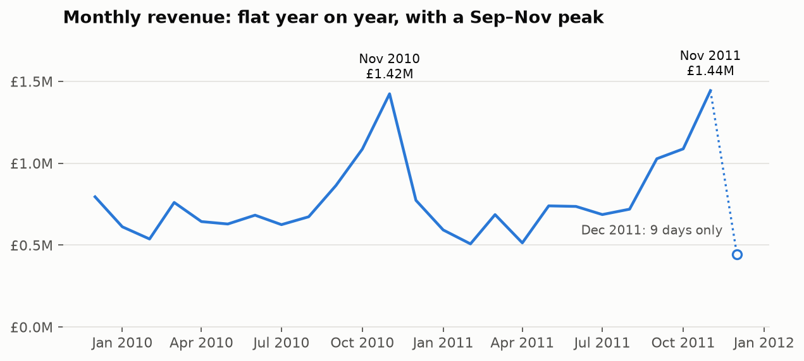
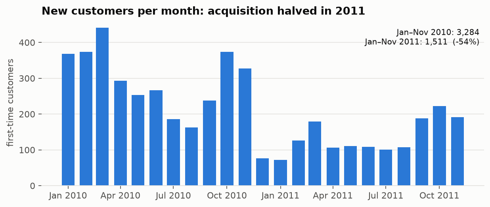
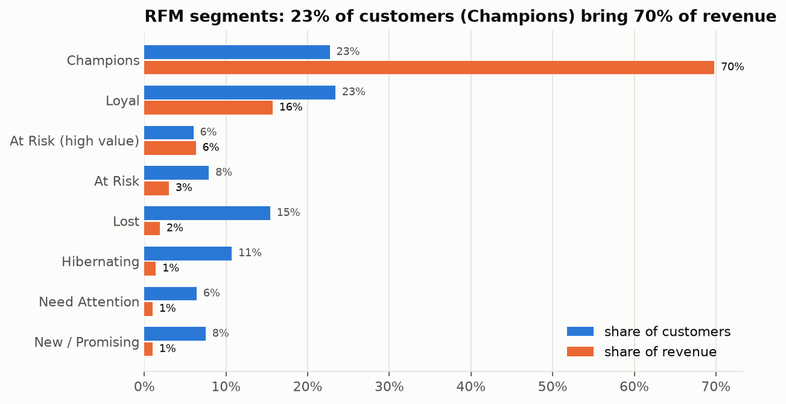
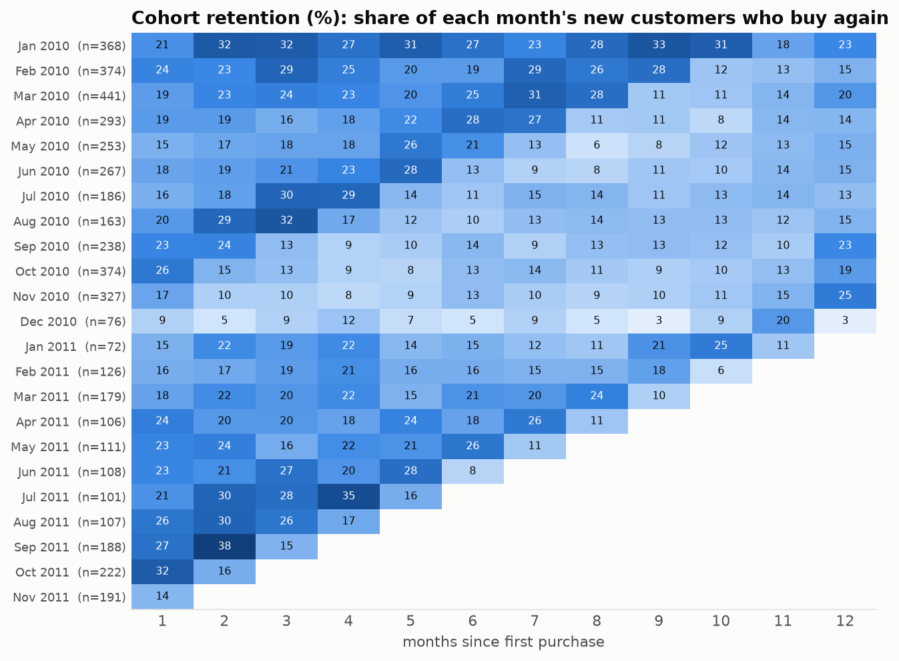
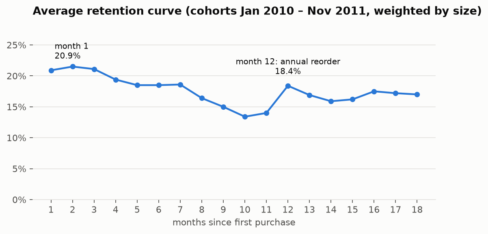

# Retail Customer Analytics: SQL + Power BI

**About 23% of customers (the "Champions" segment) bring in 70% of revenue, and new-customer
acquisition fell 54% year on year while revenue stayed flat. So this UK online gift wholesaler is
growing on loyalty, not new customers. Taken together, the findings point to three actions: protect the top accounts, win back
349 lapsed high-value customers, and fix acquisition.**

SQL analysis of 1M transactions from the UCI *Online Retail II* dataset: data cleaning, KPIs, RFM
segmentation and monthly cohort retention, written with CTEs and window functions. The result
tables are exported as CSVs for a two-page Power BI dashboard.

---

## Problem

The business is a UK-based online retailer of giftware, and most of its customers are wholesalers.
Management wants to know:

1. How are revenue, orders and customers trending, and is the growth healthy?
2. Who are the most valuable customers, and who is drifting away?
3. Do new customers come back, and how quickly?
4. Where should marketing and retention effort go next?

## Data

[Online Retail II](https://archive.ics.uci.edu/dataset/502/online+retail+ii) (UCI): every invoice line from
1 Dec 2009 to 9 Dec 2011, in 1,067,371 rows. The columns are invoice, stock code, description,
quantity, invoice date, unit price (GBP), customer id and country. `retail/load.py` downloads it.

### Cleaning

The raw data needs real work, and every step is in [`sql/01_clean.sql`](sql/01_clean.sql):

| Step | Rows |
|---|---:|
| Raw rows | 1,067,371 |
| After removing exact duplicates (the two Excel sheets overlap) | 1,033,036 |
| Same-day reversed order lines removed (see below) | 1,382 |
| **Sales lines**: product codes only, quantity > 0, price > 0, not cancelled | **1,001,935** |
| Sales lines with a customer id (used for RFM and cohorts) | 775,299 |
| Return lines (invoices starting with `C`) | 16,689 |

- **Non-product codes removed:** postage, manual adjustments, bank charges, Amazon fees, samples and
  gift vouchers. A product is a 5-digit stock code with an optional letter suffix (regex `^[0-9]{5}[A-Za-z]*$`).
- **Order-entry mistakes:** 80,995 paper birds (£168k) were invoiced and then cancelled minutes later
  on 9 Dec 2011, and the same happened with 74,215 storage jars (£77k) on 18 Jan 2011. A self-join
  finds every line that the same customer cancelled in full on the same day, and drops both sides.
  That is 1,382 lines and £420k. Without this step, December 2011 revenue and the return rate
  (3.6% before, 2.0% after) are both badly distorted.
- **Guest checkouts:** 22.6% of sales lines (13.3% of revenue) have no customer id. They count in
  revenue KPIs but are left out of customer-level analysis.
- **Partial month:** December 2011 only covers 9 days. It is flagged `is_partial_month` and
  excluded from trend comparisons.

## Approach

All analysis is SQL, run on DuckDB (PostgreSQL-compatible syntax), in four scripts:

| Script | What it builds | SQL techniques |
|---|---|---|
| [`01_clean.sql`](sql/01_clean.sql) | `sales`, `returns`, `cleaning_log` | `SELECT DISTINCT`, regex macro, self-join for reversals, row-value `NOT IN` |
| [`02_kpis.sql`](sql/02_kpis.sql) | `monthly_kpis`, `headline_kpis`, top countries and products | CTEs, `FILTER` aggregates, `lag()` for MoM and YoY growth, `rank()` + `QUALIFY` |
| [`03_rfm.sql`](sql/03_rfm.sql) | `rfm`, `rfm_segments`, `revenue_concentration` | `ntile(5)` scoring, `CASE` segment rules, running `sum() OVER`, `percent_rank()` |
| [`04_cohorts.sql`](sql/04_cohorts.sql) | `cohort_retention`, `retention_curve`, `repeat_purchase` | `first_value()`, cohort × month grid with `range()`, `row_number()` for 1st/2nd order |

**RFM:**

- Recency is days since the last order. Frequency is the number of distinct orders. Monetary is spend net of returns.
- Each is scored 1–5 by quintile.
- The scores map to 8 named segments, from Champions (R≥4, F≥4, M≥4) to Lost.

**Cohorts:**

- Each customer belongs to the month of their first purchase.
- Retention at month *k* is the share of a cohort that buys again in month *k*.
- The average curve has three safeguards:
  - It is weighted by cohort size.
  - It only counts cohorts that can be observed for *k* full months.
  - It counts months where nobody came back as 0, rather than dropping them.
- The December 2009 "cohort" is every customer active before the data starts, so it is excluded.

## Results

**Headline (Dec 2009 – Dec 2011):** £19.3M revenue · 39,397 orders · 5,850 customers ·
£490 average order value · 85% of revenue from the UK · 2.0% return rate.

### 1. Revenue is flat; growth now comes from existing customers




| Jan–Nov | 2010 | 2011 | Change |
|---|---:|---:|---:|
| Revenue | £8.54M | £8.74M | +2.4% |
| New customers | 3,284 | 1,511 | **−54%** |
| Revenue share from returning customers | 79% | 91% | +12 pts |

The business is seasonal: November revenue (£1.42–1.44M) is nearly three times February's.
Revenue held steady while new-customer numbers halved, which means existing accounts are spending
more. That is a strength, but the customer base is not being replenished.

### 2. Revenue is highly concentrated

| Top x% of customers | Share of revenue |
|---|---:|
| 1% (58 customers) | 31.2% |
| 5% | 51.2% |
| 10% | 63.2% |
| 20% | 76.8% |



| Segment | Customers | % customers | Revenue | % revenue | Median days since last order | Median orders | Median spend |
|---|---:|---:|---:|---:|---:|---:|---:|
| Champions | 1,330 | 22.7% | £11.42M | 69.8% | 17 | 11 | £3,721 |
| Loyal | 1,367 | 23.4% | £2.57M | 15.7% | 67 | 4 | £1,078 |
| At Risk (high value) | 349 | 6.0% | £1.03M | 6.3% | 334 | 6 | £1,693 |
| At Risk | 464 | 7.9% | £0.49M | 3.0% | 382 | 3 | £852 |
| Lost | 899 | 15.4% | £0.30M | 1.9% | 551 | 1 | £241 |
| Hibernating | 628 | 10.7% | £0.22M | 1.4% | 318 | 1 | £293 |
| New / Promising | 440 | 7.5% | £0.17M | 1.0% | 26 | 1 | £337 |
| Need Attention | 373 | 6.4% | £0.16M | 1.0% | 97 | 1 | £324 |

Country revenue is concentrated too. EIRE ranks second (£615k) with only **3** customers, and the
Netherlands is third (£550k) with 22. Those are large wholesale accounts, so losing one of them would show
up immediately in the totals.

### 3. One in five new customers comes back the next month




- 21% of new customers buy again in month 1. That falls to 13–14% by months 10–11, then
  **jumps to 18% at month 12**: customers come back a year later for the next season's stock.
- 72% of customers place a second order at some point. The median gap to the second order is **57 days**, and
  46% reorder within 90 days.

## Recommendations

| # | Action | Who | Why (evidence) | How to measure it |
|---|---|---|---|---|
| 1 | **Protect the top accounts.** Give them a named account manager, early access to the autumn range and volume pricing. | Champions (1,330), plus the top 1% (58 customers) | 23% of customers bring 70% of revenue, and the top 1% alone bring 31% | Champions' revenue and churn, quarter by quarter |
| 2 | **Win-back campaign** with a personal offer before the autumn buying season. | At Risk (high value): 349 customers | They used to order often (median 6 orders, £1,693 spend) but haven't ordered for a median of 334 days | Reactivation rate. Bringing back just 10% at their median spend is worth about **£59k** (illustrative) |
| 3 | **Fix acquisition.** Find out what changed in 2010 → 2011 (channels, marketing spend, trade shows), then rebuild the top of the funnel. | New prospects | New customers fell 54% year on year, while revenue only held up because existing customers spent more | New customers per month vs. the same month last year |
| 4 | **Prompt the second order.** Send a reorder reminder or a first-reorder incentive 30–60 days after the first purchase. | New / Promising (440), plus every new customer | The median gap to a 2nd order is 57 days. Month-1 retention is only 21% | Share of new customers with a 2nd order within 90 days (now 46%) |
| 5 | **Plan for the Sep–Nov peak.** Build stock and run the campaigns in August, and time win-back (action 2) and annual reminders for month 11–12 after the first purchase. | Operations, marketing | November is 2.8× February, and there is a retention bump at month 12 | Stock-outs in Q4. Month-12 retention |

**Caveats:**

- This is two years of transactions from one retailer, with no marketing, cost or margin data.
  The recommendations are about where to look, and the £ figure is illustrative, not a forecast.
- RFM is measured on net revenue, not profit.
- 13% of revenue is from guest checkouts, and they can't be segmented.

## Power BI dashboard

`python -m retail.run` exports every result table to [`powerbi/data/`](powerbi/data). The
dashboard spec has a KPI page and a customer-segment page, with the DAX measures and layout, in
[`powerbi/README.md`](powerbi/README.md).

## How to run

```bash
python -m venv .venv
.venv/Scripts/activate            # Windows; on macOS/Linux: source .venv/bin/activate
pip install -r requirements.txt
python -m retail.run              # downloads the data (~45 MB), runs sql/01–04, exports CSVs
python analysis/make_figures.py   # renders the charts in reports/figures/
```

The pipeline uses DuckDB, so no database server is needed. The SQL sticks to PostgreSQL-compatible syntax
apart from a few conveniences (`QUALIFY`, `FILTER`, `CREATE MACRO`, `range()`), which have
direct PostgreSQL equivalents.

## Structure

```
retail/
  load.py            download the UCI zip and convert both Excel sheets to Parquet
  run.py             run sql/*.sql in order on DuckDB, export result tables to powerbi/data/
sql/
  01_clean.sql       deduplicate, remove non-products and reversed orders → sales, returns
  02_kpis.sql        monthly KPIs, headline KPIs, top countries and products
  03_rfm.sql         RFM scores, segments, revenue concentration
  04_cohorts.sql     cohort retention matrix, average retention curve, repeat purchase
analysis/
  make_figures.py    README charts
powerbi/
  README.md          dashboard spec and DAX measures
  data/*.csv         Power BI data source
reports/figures/     charts
```
